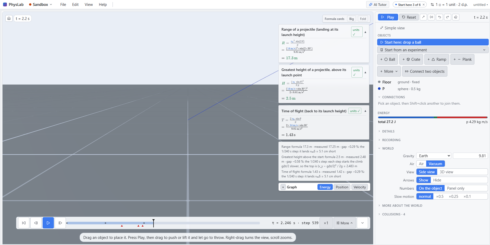
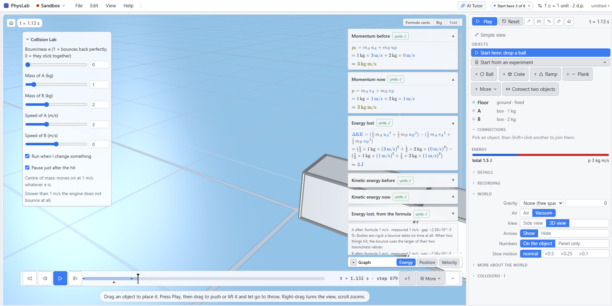

# PhysLab

**Maths and physics you can see.** A free, open-source maths and physics lab for students and teachers.
Work a problem step by step, draw it, then test it in a physics sandbox, all on your own computer and
offline (only the optional AI Tutor needs internet).

[**⬇ Download PhysLab for Windows (latest release)**](https://github.com/noob47-E/Physlab/releases/latest)

## Why PhysLab

Many schools have no science lab, and many students learn maths and physics by memorising the answers in a
guide book. PhysLab puts the working, the picture and the experiment side by side, so you can see *why*
an answer is right:

- **Free, with no hidden cost.** No subscription, no account and no adverts.
- **Works offline.** Everything except the optional AI Tutor runs with no internet.
- **Answers you can trust.** Every answer is worked out by PhysLab's own maths, and anything the AI Tutor
  says is checked against it.
- **For every learner**, from a first look at shapes to university physics, and for teachers too.

## New in 0.9 AI

- **AI Tutor (beta, optional):** ask in your own words. PhysLab checks the AI's numbers with its own engine
  and marks a right answer **Checked by PhysLab**. It needs internet and your own key.
- **New in 0.9.3:** the tutor now **draws for you**: vectors as real arrows, constructions such as Ceva's
  theorem in Geometry (it opens Geometry by itself), and it can remove what it drew. Its maths shows as
  proper maths, and it no longer shows a false "couldn't draw" warning when the drawing is there.
- **Any AI provider:** DeepSeek, Gemini, Azure OpenAI, OpenRouter or any OpenAI-compatible service, with
  a backup provider if the first one fails, and a **Thinking: Fast / Balanced / Deep** choice.
- **Live formulas in the Sandbox:** formula cards fill in with the real numbers of the run, and a gap row
  shows the formula against what the simulation measured, and says *why* they differ.
- **Record, rewind and branch:** scrub back to any moment, replay a bounce in fine steps, or change the ball
  and branch a new run from the past.
- **Collision Lab:** momentum and energy before and after, from perfectly bouncy to perfectly sticky, in 2D
  or 3D.
- **Bigger, easier-to-read text**, and the Calculator question stays in view above its working.

## What you can do

### Calculator: the working, not just the answer
Type maths the way it looks in a book. Press **Work it out** to see every step with the rule that allowed it:
factorising, long division, partial fractions, surds, complex numbers, calculus and more. Try it yourself
first with **Let me try first**, then check one step at a time.

### Graphing
Functions, circles, inequalities, polar and 3D surfaces, edited in an **Expressions list**. **Visualize** in
the Calculator opens the graph right beside your working.

### Vectors
Type vectors as `3i + 4j` or `10 ∠ 30°`, or draw them. Every operation shows its working the textbook way,
and **Draw on graph** draws exactly what the working found.

### Geometry
Sketch a rough shape and it snaps to a perfect one, with its area worked out from a formula. **Decompose**
splits a shape into rectangles and triangles. **Geometry Lego** breaks shapes into pieces you can turn, flip
and fuse back. It can also prove two triangles congruent and name the rule.

### Sandbox: a physics lab on your computer
Real objects that collide, swing and roll. Start from one of **29 experiments** (pendulum, Newton's cradle,
Atwood machine, projectiles…) or build your own with ropes, springs, rods and pulleys. Change gravity to the
Moon or Jupiter, watch energy and momentum live, record readings and send them to **Lab Data** to fit a
graph. Live formula cards show each formula with the run's own numbers, and a gap row says how far the
simulation is from the formula, and why. Rewind the tape to any moment, or branch a new run from it.

### Problem Sets
Practice with fresh numbers every time. **Hint** gives one step, not the answer, and **Check my answer** marks
what *you* worked out and names the mistake. Teachers can load their own question sets, including Numbas
`.exam` files.

### AI Tutor (beta)
Ask a question in plain words, such as *"A ball is thrown at 20 m/s at 45°. How far does it go?"* The tutor
explains the idea and the steps, and PhysLab works the numbers out again with its own engine: an answer that
agrees gets a green **Checked by PhysLab** badge. It is optional, needs internet and your own API key, and is
still learning to control every part of PhysLab, so expect rough edges.

### And more
**Lab Data** (your practical notebook: tables, plots and best-fit lines with ±), **GPU Lab** (millions of
charged particles in electric and magnetic fields), four themes, and **Start here**: six short missions that
teach the app by doing.

## Install

1. Download `physlab-ai-v0.9.exe` from the [latest release](https://github.com/noob47-E/Physlab/releases/latest).
2. Run it. Windows may warn you because the installer isn't signed yet: choose **More info → Run anyway**.
3. Updating? Just run the new installer. It replaces your older PhysLab and keeps your settings and saved work.
   Files saved in 0.9 use a new format that older versions cannot open.

This is a **preview**: it works, but you may still find bugs. Please report them in
[Issues](https://github.com/noob47-E/Physlab/issues).

Known limits: Windows only for now (a phone version is planned), and the algebra engine takes a few seconds
to start the first time you use it.

## Coming next

- **An AI with full control of PhysLab:** it will see what is on screen, build and remove anything you ask
  for in every mode, and only say it did something when PhysLab confirms it.
- **A Sandbox you build from blocks,** like a game: balls, ramps, springs, pulleys, magnets, lenses and more.
- **A Space world** for astrophysics: planets, orbits and escape velocity, without crowding the lab.
- **A new, more accurate maths engine** built on Rubi and Giac.
- 3D shapes, more experiments, and a phone version.

## Who makes it

PhysLab is led by a first-year FSc student at Forman Christian College, Lahore, who decides what gets built
and tests it. The code is written by Claude (Anthropic's Claude Opus 5 and Opus 5.5 models) under the student's
direction, and since October also by Google's Antigravity agents. The optional AI Tutor connects to an online
AI model with your own key; everything else in PhysLab is worked out by its own maths and physics.

The team: Taha Kayani (media), Umer Farooq (support), Elis Talya (research with IB and IGCSE students) and
Umme Habiba (testing).

**Thank you** to Elis Talya, Taha Kayani, Umme Habiba and Umer Farooq for their help with the research and
the testing of PhysLab.

## Support PhysLab

PhysLab is free and will stay free. If it helps you, you can support it on
[Patreon](https://www.patreon.com/cw/Noob47E), or simply share it with a student or a teacher.

## For developers

Electron + React + TypeScript, three.js (WebGPU with a WebGL2 fallback), Jolt physics in WebAssembly, mathjs,
MathLive, and Pyodide/SymPy in a worker.

| What | Command |
| --- | --- |
| Developer mode (live reload) | `npm run dev` |
| Web preview | `npm run web` |
| Unit tests, types and lint | `npm test`, `npm run typecheck`, `npm run lint` |
| Build the installer | `npm run dist` |

Read [AGENTS.md](AGENTS.md) before changing anything: it holds the rules, the architecture and the traps.
[HISTORY.md](HISTORY.md) records every version, and [docs/knowledge](docs/knowledge) explains each mode.
Contributions are welcome; see [CONTRIBUTING.md](CONTRIBUTING.md).

## Licence

[GPL-3.0](LICENSE). See [NOTICE](NOTICE) for the third-party parts.
